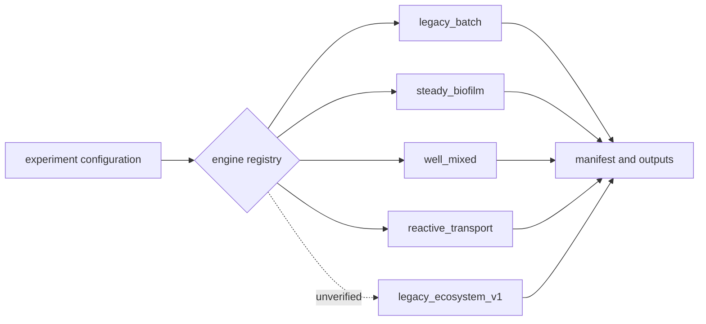

# Architecture

MARSE (Microbial Adaptability Resource Simulation Engine) is open-source
software for reproducible simulation of microbial populations and biofilms.
This repository is that software, one installable package named `marse`.

The layout below is the code as it is. Schemas and the science modules now
live in `model/`, `processes/`, `environments/` and `space/`. The numerical
engines stay where they were (`core/` and `spatial/` for the solvers);
`engines/` is the selection layer in front of them. This repository is still
one installable package.

## Principles

- **Small deterministic core, replaceable engines.** Shared infrastructure
  owns state, time, seeds, provenance and the frame store. An engine owns one
  way of advancing a configuration. `marse run` selects the engine from the
  file instead of branching on it in the command line.
- **Explicit contracts.** Configurations and providers exchange information
  through declared state that carries units.
- **Reproducibility as a feature.** Every run can be replayed from its manifest.
  The optional `engine` field is not part of that record.



## Package layout

```text
src/marse/
  cli/             one module per command; marse.cli:main is the dispatcher
  engines/         Engine protocol, registry, and one adapter per engine
  io/              frame store, result writers, and the shared run directory
  model/           configuration schema v2: formula, network, experiment, domain
  processes/       growth, kinetics, adhesion, niche, genotype, additives,
                   acid-base, biofilm biomass and packed spreading; host/ is
                   experimental
  environments/    oral/: mouth, salivary film, diet, Stephan-curve measures
  space/           grids, transport, surfaces, air, column, solutes, continuum
                   spreading
  core/            state, seeds, provenance, the legacy batch loop, and the
                   version-2 solvers (well_mixed, reactive_transport, implicit)
  spatial/         the 1-D steady solver, multigrid, and VTK export
  ecosystem/       the unverified 2-D engine (model, providers, viewer)
  analysis/        calibration, uncertainty, ensemble
  evidence/        culture evidence and context checks
  experimental/    package kept so the old host path can warn; the code is in
                   processes/host
  validation/      analytical references and the benchmark registry
  bench/           benchmark case files, the in-process adapter, metrics, reports
  ingest/          table importers and their checks; they do not run a simulation
  _compat.py       deprecated import paths
```

`adaptation/` and `interventions/` are not implemented. Importing the old
names still works for one release and warns; the modules are not in the tree.
The same hook keeps the earlier top-level names (`marse.niche`,
`marse.actions`, `marse.calibration` and the rest) and the package paths from
before this move (`marse.schemas`, `marse.microbes`, `marse.chemistry`,
`marse.biofilm`, `marse.oral`, `marse.experimental.host`, and the grid and
transport modules that left `marse.spatial`). Nothing inside MARSE imports
an old path.

These files are not in the tree, whatever an older sketch of this page said:
`microbes/resource_use.py`, `microbes/phenotype.py`, `microbes/interactions.py`,
`biofilm/matrix.py`, `biofilm/maturation.py`, `adaptation/transitions.py`,
`adaptation/policies.py`, `interventions/perturbations.py`.

## Engines

An engine validates a configuration, runs it, and replays a manifest of its
kind. The protocol is :class:`marse.engines.base.Engine`. The registry in
:mod:`marse.engines.registry` is the only place that decides which engine a
file uses.

| Engine | Manifest `kind` | When `marse run` selects it |
|---|---|---|
| `legacy_batch` | `batch` | a version-1 experiment with no biofilm block |
| `steady_biofilm` | `biofilm_profile` | a version-1 experiment with a biofilm block |
| `well_mixed` | `well_mixed` | schema version 2, no `domain` |
| `reactive_transport` | `reactive_transport` | schema version 2 with a `domain` |
| `legacy_ecosystem_v1` | `ecosystem` | `marse ecosystem`, or `engine` set explicitly |

A file may set a top-level `engine` to one of those names. The registry
removes the field before the scientific schema reads the document, so the
manifest and its checksum do not change. Replay does not read `engine`. It
uses the manifest's `kind`.

`legacy_ecosystem_v1` is unverified. `marse ecosystem`, `marse ecosystem-batch`
and a replay of an ecosystem manifest print a warning. The defects are in
[validation.md](validation.md#the-two-dimensional-ecosystem-engine-is-not-yet-verified).
Importing :mod:`marse.ecosystem` does not warn, so the test suite can treat
warnings as errors.

The numerical code has not moved. `engines/` is the selection layer in front
of `core.simulation`, `core.well_mixed`, `core.reactive_transport` and
`ecosystem.model`.

## Command line

`marse.cli` is a package. `marse.cli:main` is unchanged, and so are the
commands: `run`, `replay`, `ecosystem`, `niche-scan`, `ecosystem-batch`,
`check`. `run` and `replay` call the registry. The other commands are the
same tools they were, with the ecosystem commands now warning.

## Frame store

There is one implementation, :class:`marse.io.frames.FrameStore`. Each field
is one preallocated `.npy` file with a leading frame axis, written through a
memory map, plus an `index.json`. The store knows nothing about any engine.

:mod:`marse.core.framestore` and :mod:`marse.ecosystem.framestore` re-export
that class, so `FrameStore` is the same object from either path.
`ecosystem.framestore` also holds the ecosystem adapter (`EcosystemFrameSink`,
`StoredFrames`).

Frames are for looking at a run. The exact result is the final state in the
manifest, reproduced by `marse replay`.

Every run directory, whichever engine wrote it, contains `manifest.json`,
`summary.json` and `report.html`, plus that engine's scientific files
(trajectory or profile; totals, VTK and frames; ecosystem frames and a
viewer). `summary.json` names the engine and lists the files. It is not part
of the manifest, so `config_sha256` and the recorded outputs are unchanged
and a manifest written before this layout still replays. The parent directory
gains `index.json`, a list of those runs by folder name, with no absolute
path. `marse ls` reads the manifests. `marse compare` reports whether two
manifests share a configuration checksum and the same recorded outputs. It
does not re-run them.

## Providers

A provider is a versioned implementation of one scientific concern. The
spatial ecosystem has a concrete contract in `marse.ecosystem.providers`.
`ExplicitTransportProvider` advances one field with an explicit
two-dimensional finite-difference operator and fixed boundaries. That
operator is not verified: unlike the one-dimensional solver in
`marse.spatial.diffusion`, it has not been checked against an analytical
solution. `EcosystemProviders` declares transport, biomass spreading,
reaction, biomass and diagnostics versions, and every ecosystem result
records them.

## Run lifecycle

1. Load and validate the experiment configuration.
2. Build the initial state, and derive an independent random stream for each
   provider from the run seed.
3. Advance. Version-2 engines apply every process to the same state and check
   the mass balance. The legacy batch engine steps the organisms in order.
4. Write the outputs and the manifest. A replay re-runs from the manifest and
   compares the results.

## Provenance

Every run is replayable from its manifest. The implemented manifest
(`marse.core.provenance`) is JSON with sorted keys, so the same run produces
byte-identical output and manifests diff cleanly. The `run_id` is derived
from the configuration checksum, which means the same experiment always
carries the same identifier. Reading a manifest re-verifies the checksum, so
one edited after the run is refused.

Each manifest names its `kind`, and `marse replay` rebuilds the configuration
with the parser for that kind, then runs the engine registered for it. A
manifest whose configuration does not match its declared kind is refused.
`kind` arrived with manifest format version 2. Version 1 manifests, which
predate the ecosystem engine, remain readable: their kind is recovered from
the configuration. An ecosystem manifest also records a SHA-256 digest of the
entire final state.

### Privacy rules for manifests and outputs

Manifests and outputs are designed to be shared, attached to papers, issues
and archives, so they must never identify the person or machine that produced
them:

- no usernames, hostnames, IP addresses or environment variables;
- no absolute paths: inputs are recorded relative to the experiment file,
  with their checksum;
- platform details limited to the operating-system family and the versions of
  Python and key libraries;
- timestamps in UTC.

MARSE makes no network requests and sends no telemetry. These rules are
enforced in `marse.core.provenance` and checked by the test suite.

## Decision policies

Not implemented. A later `DecisionPolicy` may choose among predefined
simulation branches, flag uncertain states, or decide which parameter region
to explore next. It is not a package in this tree.

The action space, when it exists, is an enumerated set of typed actions. A
policy never sets physical constants or biological rates and never invents
mechanisms. The core does not depend on any external policy package.

## Dependencies

The install depends on NumPy and PyYAML. PyYAML loads benchmark case files.
Tests need pytest. Type checking needs mypy,
which CI runs against a per-module baseline (`tools/mypy-baseline.txt`): a
module that is not listed must be clean, and a listed module may not grow
new errors. Further runtime dependencies are a design change and belong in
the pull request that adds them.

## Still to do after this consolidation

The four items above are in place: the science modules have moved, runs share
a directory layout and an index, the periodontal study has a version-2
column (see [periodontal-pathogen-study.md](periodontal-pathogen-study.md)),
and the docs are an MkDocs Material site (`docs/mkdocs.yml`). What remains
in this repository:

- Moving the numerical solvers out of `core/` and `spatial/` into engine
  subpackages. `engines/` selects them; it does not contain the solvers.
- Two-dimensional biomass spreading, lineage-based adaptation, and a real
  interventions layer.
- The version-1 ecosystem engine stays, warns, and is not a validated model.
  Its known defects are unchanged. The version-2 periodontal column does not
  use those mechanisms; it also does not calibrate a pocket.

## Extension points after v1.0

The interfaces leave room for later work without changes to the core: richer
metabolic models, host-cell and immune-state models, molecular providers,
learned policies, intervention-specific models and multiscale coupling.
None of that is a package in this tree.
