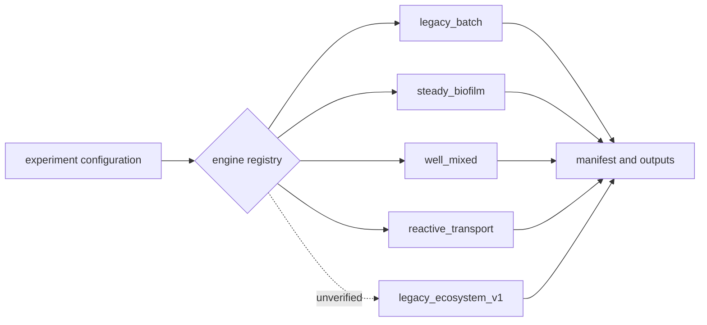

# Architecture

MARSE (Microbial Adaptability Resource Simulation Engine) is the simulation
kernel of YAUVI. YAUVI is the wider programme: data integration, a structural
workbench, a benchmark harness and an explorer. This repository is MARSE
only, one installable package named `marse`. Those other pieces are not in
this install.

The layout below is the code as it is. A later internal rearrangement
(schemas into `model/`, processes, environments, `space/`) is deliberately
not done yet; splitting into several distributions is not done yet either.
See [what is still to do](#still-to-do-from-the-consolidation).

## Principles

- **Small deterministic core, replaceable engines.** Shared infrastructure
  owns state, time, seeds, provenance and the frame store. An engine owns one
  way of advancing a configuration. `marse run` selects the engine from the
  file instead of branching on it in the command line.
- **Explicit contracts.** Configurations and providers exchange information
  through declared state that carries units.
- **Reproducibility as a feature.** Every run can be replayed from its manifest.
  The optional `engine` field is not part of that record.



## Package layout

```text
src/marse/
  cli/             one module per command; marse.cli:main is the dispatcher
  engines/         Engine protocol, registry, and one adapter per engine
  io/              the frame store (frames.py) and the shared result writers
  core/            state, seeds, provenance, the legacy batch loop, and the
                   version-2 solvers (well_mixed, reactive_transport, implicit)
  schemas/         configuration schema v2: formula, network, experiment, domain
  spatial/         grids, transport, the 1-D steady solver, surfaces, VTK
  oral/            mouth, salivary film, diet, Stephan-curve measures
  chemistry/       acid-base equilibrium
  microbes/        growth, kinetics, adhesion, niche, genotype, additives
  biofilm/         biomass and column spreading
  ecosystem/       the unverified 2-D engine (model, providers, viewer)
  analysis/        calibration, uncertainty, ensemble
  evidence/        culture evidence and context checks
  experimental/    host actions and immune pressure, outside the v1.0 claims
  validation/      analytical references and the benchmark registry
  _compat.py       deprecated import paths (marse.niche and the rest)
```

`adaptation/` and `interventions/` are not implemented. Importing the old
names still works for one release and warns; the modules are not in the tree.
The same hook keeps `marse.niche`, `marse.actions`, `marse.calibration` and
the other moved top-level modules working. Nothing inside MARSE imports them.

These files are not in the tree, whatever an older sketch of this page said:
`microbes/resource_use.py`, `microbes/phenotype.py`, `microbes/interactions.py`,
`biofilm/matrix.py`, `biofilm/maturation.py`, `adaptation/transitions.py`,
`adaptation/policies.py`, `interventions/perturbations.py`.

## Engines

An engine validates a configuration, runs it, and replays a manifest of its
kind. The protocol is :class:`marse.engines.base.Engine`. The registry in
:mod:`marse.engines.registry` is the only place that decides which engine a
file uses.

| Engine | Manifest `kind` | When `marse run` selects it |
|---|---|---|
| `legacy_batch` | `batch` | a version-1 experiment with no biofilm block |
| `steady_biofilm` | `biofilm_profile` | a version-1 experiment with a biofilm block |
| `well_mixed` | `well_mixed` | schema version 2, no `domain` |
| `reactive_transport` | `reactive_transport` | schema version 2 with a `domain` |
| `legacy_ecosystem_v1` | `ecosystem` | `marse ecosystem`, or `engine` set explicitly |

A file may set a top-level `engine` to one of those names. The registry
removes the field before the scientific schema reads the document, so the
manifest and its checksum do not change. Replay does not read `engine`. It
uses the manifest's `kind`.

`legacy_ecosystem_v1` is unverified. `marse ecosystem`, `marse ecosystem-batch`
and a replay of an ecosystem manifest print a warning. The defects are in
[validation.md](validation.md#the-two-dimensional-ecosystem-engine-is-not-yet-verified).
Importing :mod:`marse.ecosystem` does not warn, so the test suite can treat
warnings as errors.

The numerical code has not moved. `engines/` is the selection layer in front
of `core.simulation`, `core.well_mixed`, `core.reactive_transport` and
`ecosystem.model`.

## Command line

`marse.cli` is a package. `marse.cli:main` is unchanged, and so are the
commands: `run`, `replay`, `ecosystem`, `niche-scan`, `ecosystem-batch`,
`check`. `run` and `replay` call the registry. The other commands are the
same tools they were, with the ecosystem commands now warning.

## Frame store

There is one implementation, :class:`marse.io.frames.FrameStore`. Each field
is one preallocated `.npy` file with a leading frame axis, written through a
memory map, plus an `index.json`. The store knows nothing about any engine.

:mod:`marse.core.framestore` and :mod:`marse.ecosystem.framestore` re-export
that class, so `FrameStore` is the same object from either path.
`ecosystem.framestore` also holds the ecosystem adapter (`EcosystemFrameSink`,
`StoredFrames`).

Frames are for looking at a run. The exact result is the final state in the
manifest, reproduced by `marse replay`.

Output directories are still per engine (trajectory or profile; totals, VTK
and frames; ecosystem frames and a viewer). One run-directory contract for
every engine is not in place yet.

## Providers

A provider is a versioned implementation of one scientific concern. The
spatial ecosystem has a concrete contract in `marse.ecosystem.providers`.
`ExplicitTransportProvider` advances one field with an explicit
two-dimensional finite-difference operator and fixed boundaries. That
operator is not verified: unlike the one-dimensional solver in
`marse.spatial.diffusion`, it has not been checked against an analytical
solution. `EcosystemProviders` declares transport, biomass spreading,
reaction, biomass and diagnostics versions, and every ecosystem result
records them.

## Run lifecycle

1. Load and validate the experiment configuration.
2. Build the initial state, and derive an independent random stream for each
   provider from the run seed.
3. Advance. Version-2 engines apply every process to the same state and check
   the mass balance. The legacy batch engine steps the organisms in order.
4. Write the outputs and the manifest. A replay re-runs from the manifest and
   compares the results.

## Provenance

Every run is replayable from its manifest. The implemented manifest
(`marse.core.provenance`) is JSON with sorted keys, so the same run produces
byte-identical output and manifests diff cleanly. The `run_id` is derived
from the configuration checksum, which means the same experiment always
carries the same identifier. Reading a manifest re-verifies the checksum, so
one edited after the run is refused.

Each manifest names its `kind`, and `marse replay` rebuilds the configuration
with the parser for that kind, then runs the engine registered for it. A
manifest whose configuration does not match its declared kind is refused.
`kind` arrived with manifest format version 2. Version 1 manifests, which
predate the ecosystem engine, remain readable: their kind is recovered from
the configuration. An ecosystem manifest also records a SHA-256 digest of the
entire final state.

### Privacy rules for manifests and outputs

Manifests and outputs are designed to be shared, attached to papers, issues
and archives, so they must never identify the person or machine that produced
them:

- no usernames, hostnames, IP addresses or environment variables;
- no absolute paths: inputs are recorded relative to the experiment file,
  with their checksum;
- platform details limited to the operating-system family and the versions of
  Python and key libraries;
- timestamps in UTC.

MARSE makes no network requests and sends no telemetry. These rules are
enforced in `marse.core.provenance` and checked by the test suite.

## Decision policies

Not implemented. A later `DecisionPolicy` may choose among predefined
simulation branches, flag uncertain states, or decide which parameter region
to explore next. It is not a package in this tree.

The action space, when it exists, is an enumerated set of typed actions. A
policy never sets physical constants or biological rates and never invents
mechanisms. The core does not depend on any external policy package.

## Dependencies

The install depends on NumPy. Tests need pytest. Type checking needs mypy,
which CI runs against a per-module baseline (`tools/mypy-baseline.txt`): a
module that is not listed must be clean, and a listed module may not grow
new errors. Further runtime dependencies are a design change and belong in
the pull request that adds them.

## Still to do from the consolidation

- Move the scientific modules into the target internal layout (`model/`,
  `processes/`, `environments/`, `space/`) behind the current import paths.
- One run directory for every engine, and `marse ls` / `compare`.
- Port the periodontal study off ecosystem v1 onto the version-2 engine, which
  is what retires defects 1–8 for that study. The v1 command stays, and warns,
  until that port exists.
- A docs site. This page and the README are the navigation for now.

## Extension points after v1.0

The interfaces leave room for later work without changes to the core: richer
metabolic models, host-cell and immune-state models, molecular providers,
learned policies, intervention-specific models and multiscale coupling.
Those belong to YAUVI packages that do not exist in this repository yet.
